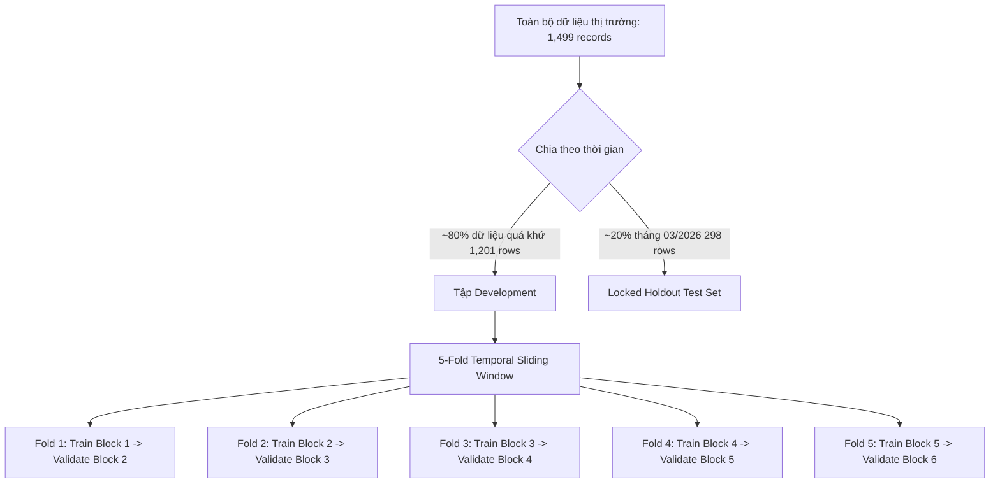

# KỊCH BẢN THUYẾT TRÌNH CHI TIẾT (CHUẨN FORM BÁO CÁO GIẢNG VIÊN)
> **Dự án:** AI Job Market Analysis & Salary Prediction Platform  
> **Trọng tâm:** Trang 04 (So sánh mô hình & CV) & Trang 05 (Chẩn đoán mô hình & Đánh giá Test)

---

## BƯỚC 1: XÁC ĐỊNH TARGET & FEATURE ENGINEERING
*(Giải quyết bài toán phân phối lệch phải & Kiểm tra tính toàn vẹn dữ liệu)*

### 1.1. Bản chất Target và biến đổi $\text{log1p}$
* **Target:** `annual_salary_usd` (Mức lương hàng năm tính theo USD).
* **Vấn đề thực tế:** Phân phối mức lương trên thị trường công nghệ bị **lệch phải rất nặng (Right-skewed)**:
  * Phần lớn công việc tập trung ở mức \$80,000 – \$220,000.
  * Có một dải đuôi dài các vị trí Director, VP, Principal kéo lên \$400,000 – \$800,000.
* **Giải pháp Feature Engineering:**
  * Chúng em áp dụng phép biến đổi:
    $$y_{\text{transformed}} = \log(1 + \text{salary}) \quad (\text{log1p})$$
  * **Tại sao phải làm vậy?** 
    1. Co ngắn dải phân phối đuôi dài, đưa target về phân phối tiệm cận chuẩn (Gaussian-like).
    2. Ổn định phương sai của sai số phần dư (Homoscedasticity), giúp các thuật toán hồi quy không bị chi phối thiên lệch bởi một vài mức lương cá biệt cực cao.
    3. Khi dự báo, ta chỉ cần giải mã ngược bằng hàm:
       $$\hat{y}_{\text{dollar}} = e^{\hat{y}_{\text{model}}} - 1 \quad (\text{expm1})$$
       để đưa về đúng đơn vị tiền USD nguyên bản.

### 1.2. Kiểm tra tính toàn vẹn: "Scaling được thực hiện ở đâu? Có bị Data Leakage không?"
> **Xác nhận từ mã nguồn hệ thống (`src/ai_job_market/core.py`):**
> * Quy trình được thực hiện **sau khi chia Train - Test**:
>   1. Dữ liệu được chia tách thời gian trước: **Development Pool (1,201 dòng)** và **Locked Holdout Test (298 dòng - tháng 03/2026)**.
>   2. Bộ tiền xử lý `StandardScaler` cho biến số và `OneHotEncoder` cho biến phân loại được đóng gói bên trong `Pipeline` của Scikit-Learn:
>      ```python
>      Pipeline([("preprocess", make_salary_preprocessor(features)), ("model", model)])
>      ```
>   3. Khi gọi `pipeline.fit(X_train, y_train)`, hàm scaling **chỉ tính toán Mean và Std trên tập Train của từng Fold**. Tập Validation và tập Test chỉ được `.transform()`.
>   4. **Kết luận bảo vệ:** Hoàn toàn **không có hiện tượng rò rỉ dữ liệu (No Data Leakage)** từ tập kiểm định hoặc tập kiểm thử vào tập huấn luyện.

---

## BƯỚC 2: THIẾT LẬP BASELINE & CÁC MÔ HÌNH ỨNG VIÊN

### 2.1. Thiết lập Baseline: Tại sao chọn Dummy Median thay vì Mean?
* **Dummy Median Baseline:** Mô hình cơ sở luôn dự đoán mức lương bằng giá trị **Trung vị (Median)** của tập huấn luyện.
* **Lý do khoa học:** Với dữ liệu lệch phải, giá trị trung bình (Mean) bị các mức lương triệu đô kéo lệch lên rất cao, không phản ánh đúng mức thu nhập của số đông. Trung vị (Median) là đại diện bền vững (robust), phản ánh chính xác điểm giữa của thị trường (50% người làm trên mức đó và 50% người làm dưới mức đó).
* **Kết quả Baseline sàn:** Đạt CV MAE = **$54,011**. Bất kỳ mô hình Machine Learning nào muốn có giá trị sử dụng đều bắt buộc phải vượt trội hơn mốc sai số $54k này.

### 2.2. Phổ 5 mô hình ứng viên (Model Families Lineup)
Chúng em lựa chọn 5 mô hình đại diện cho toàn bộ phổ lý thuyết Machine Learning từ sơ khai đến hiện đại:
1. **Dummy Median:** Mốc sàn cơ sở (Naive baseline) để định lượng độ cải thiện thực tế.
2. **Linear Regression:** Kiểm tra xem mối quan hệ giữa các biến đặc trưng $X$ và tiền lương có đơn giản là tuyến tính hay không.
3. **Ridge Regression:** Mô hình tuyến tính có điều chuẩn L2 ($\alpha \sum w_j^2$). Khi One-Hot Encoding tạo ra hàng trăm biến giả phân loại, Ridge giúp co bớt trọng số để giảm thiểu đa cộng tuyến (multicollinearity).
4. **Random Forest:** Mô hình Bagging cây quyết định. Rất mạnh trong việc học các tương tác phi tuyến tính phức tạp (Non-linear interactions) giữa các biến (ví dụ: cùng 5 năm kinh nghiệm nhưng ở mảng AI Engineering thì mức lương tăng vọt khác hẳn mảng IT Support).
5. **Gradient Boosting:** Mô hình Boosting xây dựng chuỗi cây tuần tự, mỗi cây sau tập trung học để sửa phần dư (residual/error) của cây đi trước.

---

### 2.3. Quy trình chia 5 Folds: Khác biệt cốt tử giữa Validation và Test



#### Bảng so sánh bản chất: Validation khác Test ở điểm nào?

| Tiêu chí so sánh | Tập Kiểm định (Validation Set trong 5 Folds) | Tập Kiểm thử (Holdout Test Set) |
| :--- | :--- | :--- |
| **Dung lượng mẫu** | Nằm trong 1,201 dòng của Development Pool | **298 dòng (chiếm ~20% dữ liệu, tháng 03/2026)** |
| **Số lần sử dụng** | **Được dùng lặp đi lặp lại nhiều lần** qua 5 folds | **Chỉ được dùng DUY NHẤT 1 LẦN** ở cuối dự án |
| **Mục đích sử dụng** | 1. So sánh đối đầu 5 mô hình ứng viên.<br>2. Tính các chỉ số CV MAE, RMSE, $R^2$, MedAE.<br>3. Chọn ra họ mô hình chiến thắng (Model Family Selection).<br>4. Tinh chỉnh siêu tham số (Hyperparameter Tuning).<br>5. Phân tích độ nhạy và tinh giảm đặc trưng (Ablation). | Đóng vai trò là **"Thước đo sự thật độc lập (Ground Truth)"** để đánh giá khả năng tổng quát hóa out-of-sample của mô hình hoàn chỉnh khi đối mặt với dữ liệu tương lai chưa từng thấy. |
| **Quyền can thiệp** | Cho phép nhà phát triển nhìn vào để tinh chỉnh mô hình | **Bị khóa cứng hoàn toàn**, không được can thiệp vào quá trình chọn biến hay học tham số |

---

## BƯỚC 3: ĐỌC KẾT QUẢ ĐỐI ĐẦU 5 MÔ HÌNH (QUAY LẠI 5 MODELS)

### 3.1. Điểm đắt giá của bộ 5 mô hình
> *"Điểm hay của tập 5 model này là trải dài từ **Naive baseline $\rightarrow$ Tuyến tính $\rightarrow$ Tuyến tính có điều chuẩn $\rightarrow$ Bagging trees $\rightarrow$ Boosting trees**. Vì vậy, việc Random Forest chiến thắng không phải là do so sánh với một mô hình rơm (straw-man) yếu ớt, mà nó đã vượt qua toàn bộ các họ giải thuật tiêu biểu."*

### 3.2. Bảng thông số đo lường toàn diện

| Mô hình | CV MAE (USD) | CV RMSE (USD) | CV $R^2$ | CV MedAE (USD) | Thời gian Fit (giây) | Trạng thái so sánh |
| :--- | :---: | :---: | :---: | :---: | :---: | :--- |
| **Dummy (Median)** | \$54,011 | \$70,447 | -0.228 | \$43,200 | 0.015s | Baseline sàn tham chiếu |
| **Linear Regression** | \$59,006 | \$75,094 | -0.520 | \$47,600 | 0.011s | Thất bại do phi tuyến & đa cộng tuyến |
| **Ridge Regression** | \$28,057 | \$38,265 | 0.637 | \$19,982 | 0.018s | Giảm gần 50% lỗi nhờ điều chuẩn L2 |
| **Random Forest** | **\$15,662** | **\$26,821** | **0.822** | **\$7,452** | 0.210s | **Hạng 1 - Tối ưu toàn diện** |
| **Gradient Boosting**| \$16,421 | \$26,943 | 0.821 | \$9,490 | 0.214s | Hạng 2 - Bám sát nút |

### 3.3. Hướng dẫn đọc các thông số quan trọng:
1. **MAE và RMSE thấp:**
   * **Cảnh báo khoa học:** Với target lệch phải, RMSE cực kỳ nhạy cảm với các ngoại lai và rất dễ bị thổi phồng bởi một vài mức lương executive cực lớn. Do đó, ta **bắt buộc phải nhìn đồng thời MAE và MedAE** để có cái nhìn công bằng về sai số điển hình.
2. **$R^2$ cao:** Đo lường tỷ lệ phương sai mức lương được giải thích. RF giải thích được tới **82.2%** biến động lương.
3. **MedAE thấp:** Cho thấy 50% số công việc trên thị trường được mô hình dự đoán chỉ lệch dưới **\$7,452**.
4. **Thời gian huấn luyện (Training time):** Cả RF và GB chỉ tốn ~0.21 giây để huấn luyện, hoàn toàn khả thi để cập nhật định kỳ (retraining) trên hệ thống web.

### 3.4. Điểm then chốt: Phân tích đối đầu Random Forest vs. Gradient Boosting
Hai mô hình cây Ensemble bám đuổi nhau cực kỳ sát sao:
* **Hệ số $R^2$:** RF đạt **0.822**, GB đạt **0.821** $\rightarrow$ **Chênh lệch chỉ vỏn vẹn 0.001**.
* **Sai số tuyệt đối MAE:** **Random Forest có MAE thấp hơn khoảng \$759/job** (\$15,662 so với \$16,421).
* **Sai số trung vị MedAE:** Random Forest đạt **\$7,452**, tốt hơn đáng kể so với **\$9,490** của GB.
* **Độ ổn định phương sai:** Gradient Boosting có độ lệch chuẩn sai số giữa các fold thấp hơn một chút (MAE SD: \$2,529 so với \$2,935 của RF).
* **Quyết định lựa chọn:** Evidence thực nghiệm khẳng định cả 2 họ cây đều xuất sắc. Nhóm quyết định lựa chọn **Random Forest** làm kiến trúc hạt nhân để đi tiếp vào quy trình tinh chỉnh siêu tham số chuyên sâu vì:
  1. Cho sai số trung bình (MAE) và sai số điển hình (MedAE) trên mỗi vị trí công việc thấp hơn.
  2. Dễ giải thích tầm quan trọng đặc trưng hơn và ít bị nhạy cảm quá mức với các category hiếm.

---

## BƯỚC 4: KẾT QUẢ SAU TUNING CỦA RANDOM FOREST & CẤU HÌNH TỐI ƯU

Sau khi chọn Random Forest, quy trình thực hiện khảo sát độ nhạy trên các fold kiểm định theo 4 siêu tham số cốt lõi:

```
Cấu hình tối ưu được chốt:
n_estimators = 200 | max_depth = 20 | min_samples_leaf = 1 | max_features = 0.7
```

### 4.1. Ý nghĩa và cơ sở khoa học của từng tham số:
1. **`n_estimators = 200`:** Nhiều cây giúp dự đoán của toàn bộ khu rừng ổn định hơn, giảm thiểu phương sai ngẫu nhiên. Tăng từ 100 lên 200 cây giúp MAE giảm rõ rệt; trên 200 cây sai số bão hòa không giảm thêm.
2. **`max_depth = 20`:** Mỗi cây được phép sâu tối đa 20 tầng phân nhánh. Đủ sâu để mô hình học được các tương tác đa tầng giữa ngành nghề, kỹ năng và thâm niên, đồng thời chặn đứng nguy cơ phân nhánh vô hạn (bloat tree) gây học vẹt.
3. **`min_samples_leaf = 1`:** Một nút lá có thể chứa tối thiểu 1 hồ sơ công việc. Cho phép mô hình phân giải chi tiết các vị trí chuyên biệt ít mẫu, trong khi tính chất lấy trung bình của 200 cây đã tự động bảo vệ mô hình khỏi overfit.
4. **`max_features = 0.7` (LUẬN ĐIỂM ĐẮT GIÁ NHẤT):**
   * Mỗi lần tìm điểm rẽ nhánh (split), cây chỉ được bốc ngẫu nhiên **70% số lượng đặc trưng**.
   * **(*) Giải thích nguyên lý:** *"Nếu tất cả các cây luôn luôn được nhìn toàn bộ 100% đặc trưng, một vài đặc trưng cực mạnh như `job_category` sẽ thống trị hoàn toàn ở nút gốc của hầu hết mọi cây trong rừng, khiến các cây trở nên quá giống nhau (Correlated Trees). Bằng việc khống chế `max_features = 0.7`, ta ép buộc các cây phải rẽ nhánh dựa trên những biến khác như kinh nghiệm, quy mô công ty, quốc gia. Điều này giúp **phi tương quan hóa các cây (De-correlate the trees)**, từ đó phát huy tối đa sức mạnh triệt tiêu phương sai sai số của thuật toán Ensemble!"*

---

## BƯỚC 5: KẾT QUẢ CV CỦA FULL 13-FEATURE TUNED MODEL VÀ KIỂM CHỨNG TRÊN TẬP TEST

Sau khi áp dụng cấu hình tối ưu trên bộ 13 đặc trưng đầy đủ, kết quả kiểm định đạt được bước tiến rõ rệt:

### 5.1. Kết quả Cross-Validation (Tập Development - 1,201 records):
* **CV MAE:** Giảm xuống còn **\$15,594** (cải thiện thêm so với mức \$15,662 ban đầu).
* **CV $R^2$:** Đạt **0.824** (tăng từ 0.822).
* **CV MedAE:** Đạt **\$7,280**.
* **CV RMSE:** Đạt **\$26,747**.

### 5.2. Mở khóa tập Test độc lập (Locked Holdout Test - 298 records, tháng 03/2026):
Khi đưa mô hình hoàn chỉnh vào chấm điểm trên 298 dòng dữ liệu tương lai chưa từng thấy:
* **Historical Test MAE:** Đạt **\$14,735** (giảm thêm **\$859** so với CV MAE $\rightarrow$ mô hình tổng quát hóa cực kỳ vững chắc).
* **Historical Test $R^2$:** Đạt **0.813** (độ sụt giảm so với CV $R^2$ chỉ là **0.011**, chứng minh không bị quá khớp).
* **Historical Test MedAE:** Đạt **\$4,347** (sai số điển hình cực kỳ ấn tượng).
* **Dải bất định an toàn $q90$:** **$\pm \$40,068$** (chính xác **89.9%** các công việc trên tập test có sai số thực tế nằm trọn trong dải này).
